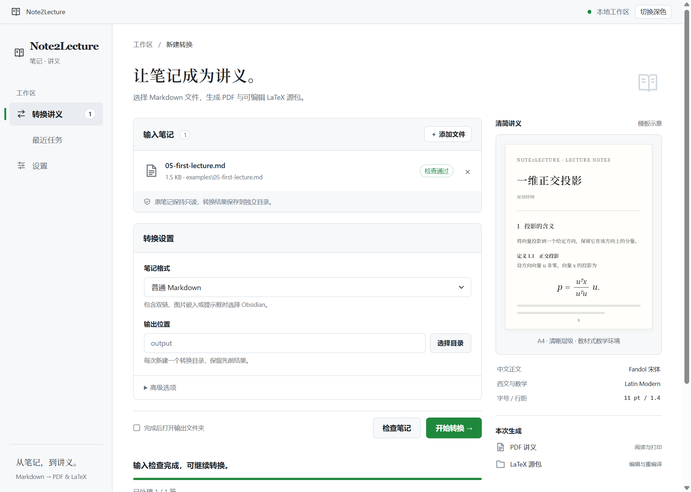
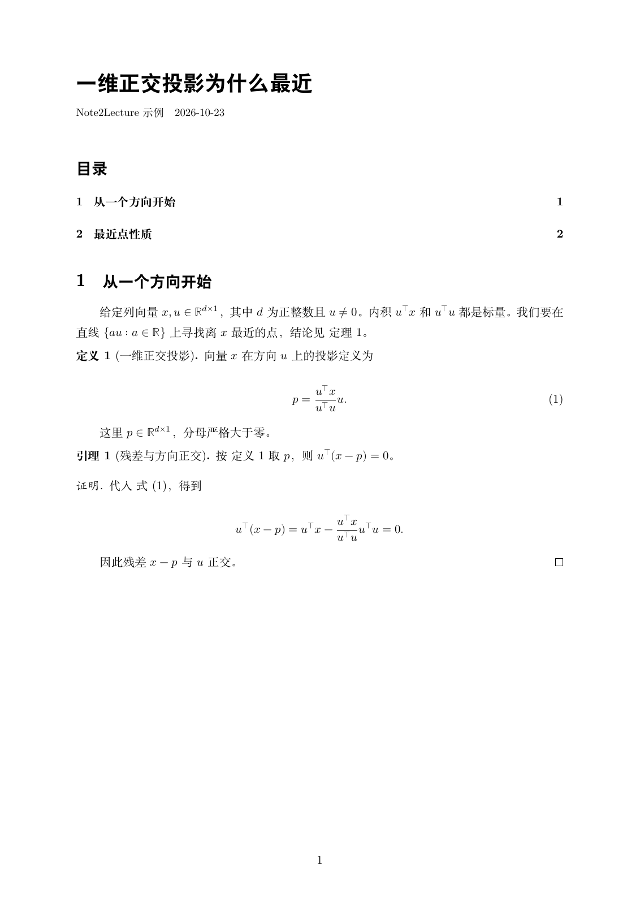

# Note2Lecture

把明确选定的 Markdown 与本地图片转换为中文讲义 **PDF＋可编辑 LaTeX 源包**，支持单篇与批量导出。面向 Windows 本地命令行使用，基础转换不需要 GPU 或模型。

[Windows 首次使用](docs/quickstart-windows.md) · [公开效果对照](docs/demo.md) · [命令与输出](docs/usage.md) · [批处理](docs/batch-export.md)

Windows 用户也可使用新的 [本地桌面界面](docs/desktop-gui.md)：安装可选的 `requirements-gui.txt` 后，运行 `.\.venv\Scripts\python.exe note2lecture_gui.py`，选择笔记并检查或转换。界面支持浅深色、中文诊断及结果打开，沿用现有 PDF / LaTeX 转换器。

## 从窗口开始

已配置好环境后，在本地项目目录双击 **[Start Note2Lecture.cmd](<Start Note2Lecture.cmd>)** 即可启动，无需每次输入命令。启动器使用项目自己的 `.venv`，失败时弹出提示并保留日志。

先按 [Windows 指南](docs/quickstart-windows.md) 准备 Python、Quarto、XeLaTeX、宏包与字体，在源码目录打开 PowerShell：

```powershell
py -3.12 -m venv .venv
.\.venv\Scripts\python.exe -m pip install -r requirements-gui.txt
.\.venv\Scripts\python.exe note2lecture.py doctor
.\.venv\Scripts\python.exe note2lecture_gui.py
```

已有项目环境时无需重建。GUI 另需 Windows WebView2 Runtime；工具未加入 PATH 时，按指南设置已有 Quarto 的位置。点击“添加文件”，选择 [首次体验样例](examples/05-first-lecture.md)，保持“普通 Markdown”，先检查，再开始转换。



截图来自真实窗口的公开样例演示，机器路径仅在截图展示时替换为相对路径；右侧是模板示意，不是笔记实时预览。

| 当前候选版体验 | 材料 |
| --- | --- |
| 普通 Markdown、公式、图片、JSON 与 PowerShell | [原稿](examples/05-first-lecture.md) · [PDF](docs/demo/v0.1.0/05-first-lecture.pdf) · [可编辑源包](docs/demo/v0.1.0/05-first-lecture-source.zip) |
| 验证范围与发布边界 | [候选验收](docs/release-candidate.md) · [v0.1.0 发布说明](docs/release-notes-v0.1.0.md) |

## 先看效果

四篇历史固定样例展示正文与代码、数学环境、公式图表及基础 Obsidian 语法；新增首次体验样例单独记录当前候选版结果。完整 PDF 和可编辑源包见 [演示页面](docs/demo.md)，所有演示都不使用私人笔记。



首套“清简讲义 v0.1”：Fandol 中文＋Latin Modern 西文与数学，11 pt、1.4 行距、教材式无框数学环境。

## 跑通第一篇

先按 [首次使用指南](docs/quickstart-windows.md) 准备 Python、Quarto、XeLaTeX、宏包与字体。在项目目录新建独立环境并安装两个运行依赖后：

```powershell
.\.venv\Scripts\python.exe note2lecture.py doctor
.\.venv\Scripts\python.exe note2lecture.py check examples/01-mean.md
.\.venv\Scripts\python.exe note2lecture.py export examples/01-mean.md -o output/my-first-lecture
```

打开 `output/my-first-lecture/lecture.pdf` 阅读，`lecture-source.zip` 保存可编辑完整源包。输出目录必须尚不存在；再次导出请换新目录。

普通笔记使用 `--profile markdown`，受支持的 Obsidian 扩展使用 `--profile obsidian`，默认 `strict` 对应明确的 N0.1 规范。批处理示例：

```powershell
.\.venv\Scripts\python.exe note2lecture.py batch examples/01-mean.md examples/02-projection.md examples/03-online-mean.md -o output/my-batch-01
```

每篇产物分别位于 `001`、`002`、`003`，根目录提供 `batch-summary.json`。一篇失败后继续其余项；输出和状态的完整说明见 [批处理文档](docs/batch-export.md)。

## 当前能力与边界

- 中文正文、标题目录、列表、脚注、代码、基础表格、本地 PNG/JPEG、公式、显式数学环境与编号引用。
- 普通 Markdown 适配，以及样例覆盖的 Obsidian 双链、图片嵌入和 note/tip/warning 提示框；不同模式的支持规则分别说明。
- 诊断缺图、标签与引用错误、不支持语法及编译或版面问题。部分超宽公式可在外层关系符处分行，无法安全处理时明确报告。
- markdown / obsidian 模式支持同行及跨行的 `$$` 公式、段落内同行独立公式和基础 `array` 增广矩阵，保留数学原文及分隔竖线；详细边界见输入规则。
- 原笔记与资源只读，代码不执行，模型关闭。源包包含重编译所需文本、图片和模板，工具及字体由使用者准备。

新导出的 `partial` 表示仍需内容与页面人工检查；结构与编译成功不等于数学审校或任意文档都能通过。跨笔记链接不自动合并正文，程序不自动搜图或修正失效资源路径。

N1、N2 当前约定范围及 N4 批处理已验收。真实笔记回归包括 105 页长文和五篇共 142 页讲义，用户认可阅读效果；184 项测试与 Ruff 的 N4 基线通过，私人产物仅留本机。N5 本轮整理首次使用、公开演示和复现，结果见 [N5 记录](docs/n5-validation.md)。规划版本仍为 v0.2。

随后补齐常见数学写法、[数学命令](docs/math-commands.md)、六级标题和数字/字母/罗马有序列表；宽公式优先分行再有限缩放，题号可显式保留。最新再支持数学书名、带说明的矩阵变换、标准黑方块与公式内部空行，**360 项测试与 Ruff 通过**；原创两页及源包迁移检查通过，三篇指定笔记共 2,132 处数学盒子预检通过，详见 [矩阵兼容说明](docs/matrix-compat.md)。数学预检不代替私人整篇导出与页面验收；其他引用容器仍有限制。原稿只读，公开演示保持生成时的固定产物；具体范围见 [当前工作](docs/current-work.md)。

其后补齐正文希腊字母和 ✓、⚠、❌、💡 的黑白字形，改善缺字候选定位并明确中间表格列边界。**最新 377 项测试与 Ruff 通过**，独立原创一页样张、内容与源包迁移核对通过；助手完成三篇输入及问题字符零页检查；用户随后确认个人笔记转换结果无误。字体依赖与范围见 [特殊字符说明](docs/text-glyphs.md)。

当前提供可选 Windows 桌面入口，实际窗口的原生文件选择、检查、单篇导出与失败隔离批处理通过；原创三页及源包核对通过。试用中补齐 json、powershell 等普通代码语言标签，**最新 425 项测试与 Ruff 通过**，两份项目文档及原创代码样张共 16 页的内容、页面与源包核对通过。用户于 2026-10-27 确认 GUI 制作阶段结束，详见 [桌面界面说明](docs/desktop-gui.md)。

HTML、Word/EPUB、独立打包和模型建议留待后续分别验收。电子书 PDF 反向提取按规划第 7.1 节作为独立功能，尚未启动。当前不提供一键安装器，程序不会自动下载或安装依赖。

## 文档入口

| 需要 | 文档 |
| --- | --- |
| 第一次配置并导出 | [Windows 首次使用](docs/quickstart-windows.md) |
| 查看原稿、PDF 与源包 | [公开效果对照](docs/demo.md) |
| 命令、产物和 LaTeX 重编译 | [使用说明](docs/usage.md) |
| 一次转换明确选定的文件 | [批处理](docs/batch-export.md) |
| 输入规则 | [strict / N0.1](docs/input-spec.md)、[Markdown](docs/markdown-profile.md)、[Obsidian](docs/obsidian-fixture.md) |
| 测试和工程验收 | [开发验证](docs/development.md)、[N5 复现](docs/n5-validation.md)、[N4 记录](docs/n4-validation.md) |
| 项目安排和协作 | [当前工作](docs/current-work.md)、[规划](PROJECT_PLAN.md)、[AGENTS.md](AGENTS.md) |

公开演示的来源与展示授权见 [原创样例说明](examples/README.md)。下载、安装和 Git 写操作按项目协作约定执行；私人输入和导出产物不自动上传或加入公开仓库。

v0.1.0 已通过本轮候选验收，实际发布版本与对应源码见 [GitHub Releases](https://github.com/IniJyou/note2lecture/releases)。仓库尚未设置覆盖整个项目的代码许可证，样例授权不替其他文件设定许可；字体和第三方工具不随演示源包分发。
