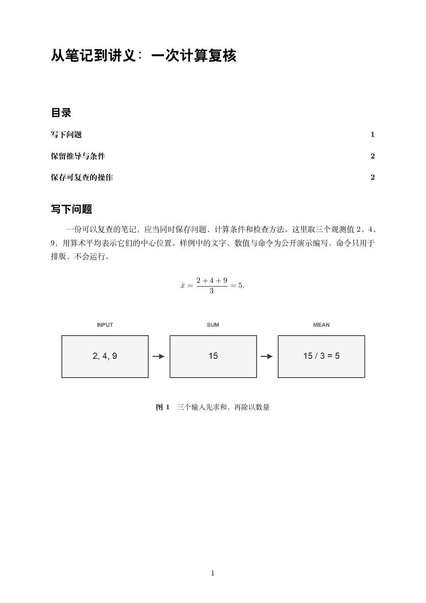
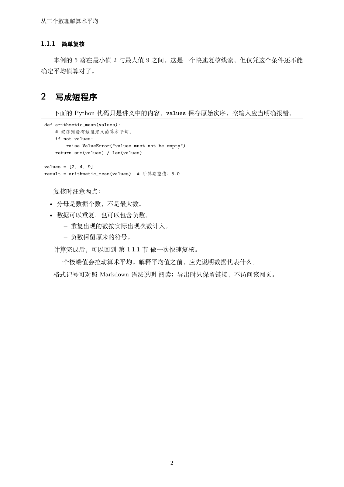
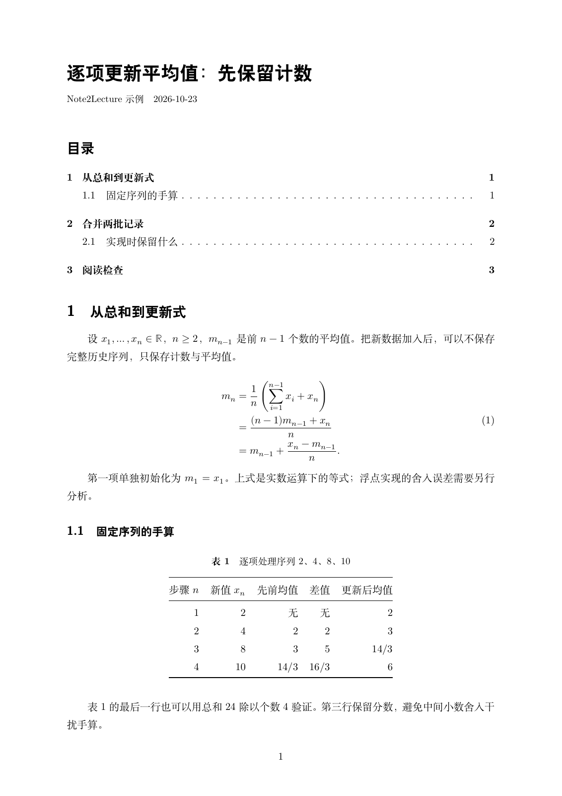
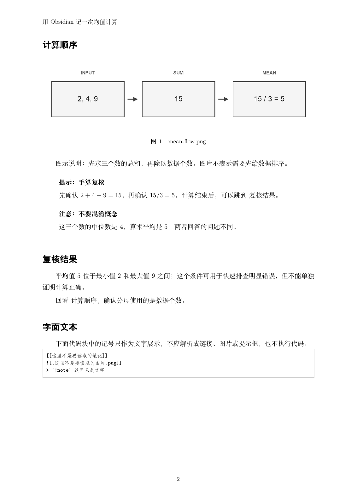

# 原创笔记转换效果

## 当前候选版：从窗口完成第一次转换

v0.1.0 候选准备新增一篇普通 Markdown 笔记，展示均值与平方距离公式、图片、表格，以及 JSON / PowerShell 代码。三条观测值为 2、4、9，与复用的原创均值流程图一致。原稿代码不执行。

[Markdown 原稿](../examples/05-first-lecture.md) · [完整 PDF](demo/v0.1.0/05-first-lecture.pdf) · [可编辑 LaTeX 源包](demo/v0.1.0/05-first-lecture-source.zip)



运行方式见 [首次使用](quickstart-windows.md)，GUI 实际截图见 [桌面界面](desktop-gui.md)，本轮条件与检查见 [候选验收](release-candidate.md)。当前产物与 [验证清单](demo/v0.1.0/validation.json)单独保存。

## 四篇历史固定演示

以下四篇输入与图片都由 Note2Lecture 为演示原创编写，来源和展示授权见 [样例说明](../examples/README.md)。基础转换关闭模型，笔记代码只排版，不执行。点击原稿查看 Markdown 写法，点击讲义查看完整 PDF；源包可解压编辑并用 XeLaTeX 重编译。

以下 PDF、源包和预览图保留 2026-10-26 的生成结果与原摘要；它们用于展示各类结构，不能当作当前 GUI 或最新模板重新验收的证据。

| 示例 | 主要展示 | Markdown 原稿 | 完整讲义 | 可编辑源包 |
| --- | --- | --- | --- | --- |
| 算术平均 | 中文正文、图片、脚注、代码与编号引用 | [原稿](../examples/01-mean.md) | [PDF](demo/01-mean.pdf) | [LaTeX ZIP](demo/01-mean-source.zip) |
| 一维投影 | 定义、引理、定理、证明、公式与交叉引用 | [原稿](../examples/02-projection.md) | [PDF](demo/02-projection.pdf) | [LaTeX ZIP](demo/02-projection-source.zip) |
| 在线平均 | 多行公式、表格、图片、长代码与分页 | [原稿](../examples/03-online-mean.md) | [PDF](demo/03-online-mean.pdf) | [LaTeX ZIP](demo/03-online-mean-source.zip) |
| Obsidian 均值笔记 | 双链、图片嵌入、同篇跳转与提示框 | [原稿](../examples/04-obsidian.md) | [PDF](demo/04-obsidian.pdf) | [LaTeX ZIP](demo/04-obsidian-source.zip) |

## 数学环境：从明确标记到正式讲义

投影示例中的一段输入如下。环境由显式标记确定，原公式及非零条件保留。

```markdown
::: {#def-projection}

## 一维正交投影

向量 $x$ 在方向 $u$ 上的投影定义为

$$
p=\frac{u^\top x}{u^\top u}u.
$$ {#eq-projection}

这里 $p\in\mathbb{R}^{d\times 1}$，分母严格大于零。
:::
```


## 正文与代码

原稿的代码围栏保存代码正文，生成讲义使用等宽字体排版；图片与编号引用随文保留。



## 公式、表格与图片

在线平均示例保留公式推导、表格中的中间分数与图片图题。长内容可以自然分页，代码原文不会为适应页面而被删除。



## Obsidian 基础语法

原稿中的 `[[#复核结果|复核结果]]` 转成同篇跳转，`![[assets/mean-flow.png]]` 打包原图，note/tip/warning 提示框保留题头和内容。跨笔记双链显示引用信息并发出预期 warning，不合并另一篇正文。



## 自己复现

准备方式见 [Windows 首次使用](quickstart-windows.md)。在项目目录运行：

```powershell
.\.venv\Scripts\python.exe note2lecture.py export examples/01-mean.md -o output/demo-mean-new
.\.venv\Scripts\python.exe note2lecture.py batch examples/02-projection.md examples/03-online-mean.md -o output/demo-batch-new
.\.venv\Scripts\python.exe note2lecture.py export examples/04-obsidian.md --profile obsidian -o output/demo-obsidian-new
```

模板为“清简讲义 v0.1”：Fandol 中文、Latin Modern 西文与数学，11 pt、1.4 行距，教材式无框数学环境。其他笔记不自动继承固定演示的验收结果；支持边界见 [输入规范](input-spec.md)、[Markdown 适配](markdown-profile.md) 和 [Obsidian 扩展](obsidian-fixture.md)。

本次四篇依次为 **2、2、3、2 页，共 9 页**，全部渲染并实际查看；79 处数学原文、3 个代码块、1 处行内代码、1 张表格、3 处图片引用及源包迁移重编译核对通过。Obsidian 示例保留两条预期的跨笔记引用 warning。

生成环境、内容与页面检查结果记录在 [N5 复现记录](n5-validation.md)，固定文件摘要见 [演示验证清单](demo/validation.json)。字体文件和第三方工具不随演示源包分发。
