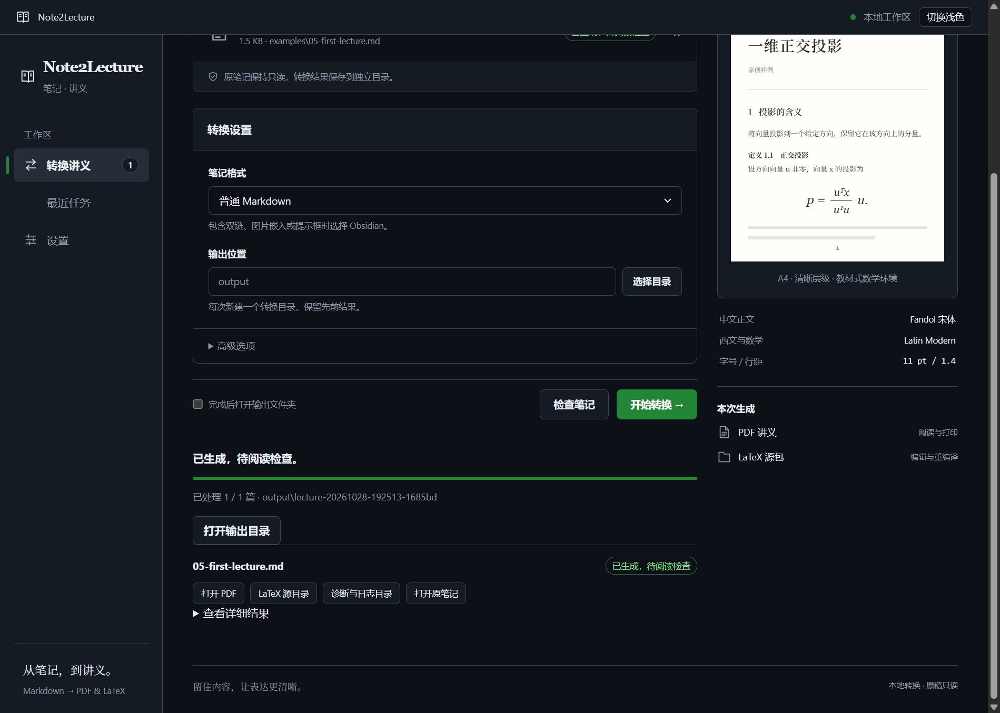

# Windows 桌面界面

日期：2026-10-27。首版为本地桌面窗口，采用灰白细边框、绿色主按钮与讲义式标题，支持浅色和深色。复用现有输入检查、单篇导出和批处理，生成 PDF 与可编辑 LaTeX 源包。

第一次使用从 [Windows 安装与首次转换](quickstart-windows.md)开始，公开体验选择 `examples/05-first-lecture.md` 和“普通 Markdown”。包含 GUI 的同机新环境复现见 [候选验收](release-candidate.md)。




两张图来自真实窗口与实际公开样例转换。仅在截图展示时把机器目录替换成相对路径，避免携带开发者绝对路径；没有修改转换报告。右侧为固定模板示意。截图来源与摘要见 [截图清单](gui/validation.json)。

## 启动

完成首次环境配置后，双击根目录 **[Start Note2Lecture.cmd](<../Start Note2Lecture.cmd>)** 即可打开窗口；可以从其他工作目录启动，也支持项目路径含中文与空格。它使用项目 `.venv`，缺少环境时给出中文提示，不改用系统 Python，不自动安装。

已有 Quarto 未加入 PATH 时，在 GUI“高级选项”选择其实际程序路径，保存后后续双击继续使用。启动日志在 `.cache/gui/launcher/`，stdout / stderr 每次单独保存；正常退出不会额外弹窗。该目录继续受 Git 忽略，日志留本机。

在项目目录、已准备基础转换环境的前提下，由使用者安装可选界面依赖并启动：

```powershell
.\.venv\Scripts\python.exe -m pip install -r requirements-gui.txt
.\.venv\Scripts\python.exe note2lecture_gui.py
```

已有本项目 GUI 依赖时只需运行第二行。当前从源码目录启动，没有独立 EXE 或安装器。命令行入口和原来的两个运行依赖继续可用，不要求为了 CLI 安装界面库。

GUI 首轮已验证 Python 3.12.4、pywebview 6.2.1、pythonnet 3.2.1 与当时的 WebView2 Runtime 155.0.4283.62；2026-10-28 候选复现时系统运行时为 156.0.4314.50，同样通过；仍复用原来的 Quarto / XeLaTeX。Windows 需要 WebView2 和 .NET Framework，参见 [pywebview 官方安装说明](https://pywebview.flowrl.com/guide/installation.html)及 [Windows 渲染引擎说明](https://pywebview.flowrl.com/guide/web_engine.html)。本次用户授权助手在项目 `.venv` 安装可选库；程序运行时不会自动安装依赖。尚未验收其他操作系统或独立打包。

## 使用

1. 点击“添加文件”，选一篇或多篇 `.md`。重复选择同一文件不会重复加入；不扫描笔记库或所选文件夹。
2. 选择笔记格式，默认普通 Markdown；双链、图片嵌入或提示框使用 Obsidian。严格规范对应既有 N0 输入协议。
3. 选择输出父目录。每次导出自动新建唯一的 `lecture-日期时间-短标识` 目录，保留旧结果。单篇直接包含讲义文件，多篇沿用 `001`、`002` 等编号目录与批次汇总。
4. 可先点击“检查笔记”，查看原稿位置与诊断；“开始转换”也会执行现有转换器的输入校验。
5. 完成后，在各条目打开 PDF、LaTeX 源目录、诊断目录或原笔记。也可勾选完成后自动打开输出文件夹。

高级选项提供保留原题号及已有 Quarto 程序路径。其含义与命令行相同，参见 [使用说明](usage.md)与 [批处理规则](batch-export.md)。界面右侧是当前模板的排版示意，不是所选笔记的实时预览。

## 任务与诊断

- 任务在后台线程中调用现有转换器，界面继续响应；只同时执行一个任务，运行中锁定文件清单与设置。
- 进度显示当前文件及已处理篇数。单篇内部使用不确定进度动画，不把耗时猜成准确百分比。
- “停止后续”等待当前文件完成再停止，不强杀正在写出的 TeX / 源包。尝试关闭运行中的窗口时会提示；当前任务结束后可关闭。
- 检查失败或编译缺字、溢出等错误显示为失败；单篇出错后批处理继续处理其余文件。“已生成，待阅读检查”保留原来的 `partial` 含义，不把编译成功改成内容或页面验收通过。
- 诊断保留原文件名、行列、近似标记、相关位置和建议。详细结果可展开；不会改写已有 diagnostics 或批次汇总。
- “最近任务”仅保留当前会话最近 10 项，退出后清空。导出的文件、原始报告和日志继续保存在各自目录。

## 本地数据与设置

原笔记及直接图片保持只读，笔记代码不执行，模型继续关闭。界面只装入随项目提供的本地 HTML/CSS/JS，通过 [pywebview 的本地通信桥](https://pywebview.flowrl.com/guide/interdomain.html)调用有限操作；不加载笔记为网页、不提供笔记浏览服务器，不通过远程服务转换文件。动态文件名和诊断使用文本节点显示。

主题、输出父目录、笔记格式等偏好保存在 Git 忽略的 `.cache/gui/settings.json`；不持久化所选笔记清单或正文。WebView2 临时数据也放在该缓存目录。结果打开按钮仅接受当前会话记录的原稿和生成文件；找不到或已越出任务目录时给出提示。

## 工程检查

- **394 项 pytest 通过**，其中新增 17 项 GUI 会话测试覆盖重复选择、输入保护、失败隔离、忙碌状态、停止后续、选项传递、设置保存及结果打开边界。Ruff、JavaScript 语法与差异检查通过。
- 在实际 WebView2 窗口中操作原生多选文件和文件夹对话框，完成原创输入检查、单篇导出、含一项错误的三篇批处理；结果为前后两项生成、中间一项正确定位失败，继续处理行为通过。PDF 打开按钮的桥接与目标路径经受控打开器核对，不代替使用者本机默认阅读器的体验确认。
- GUI 共生成三份一页原创 PDF；7 处数学原文、两次原图打包、ZIP 字节、正文和独立源包迁移重编译核对通过，三页均已查看，无缺字或溢出。原稿摘要保持。
- 实际查看浅深色界面及结果页；核对固定导航、转换按钮可达、最小 1000×720 逻辑窗口无横向溢出、深色状态文字对比及动态文本不解释成 HTML。
- 使用真实 `note2lecture_gui.py` 入口启动窗口，确认“添加文件”就绪后正常关闭，退出码为 0；启动器子进程识别的前期测试问题保留在本机记录中。
- 证据仅留在 Git 忽略的 `output/gui-startup-20261027/`、`output/gui-e2e-20261027-v6/` 与 `output/gui-ui-review-20261027/`。前期测试脚本的自动化适配失败记录保留，没有覆盖旧目录；最终测试使用原创笔记，没有读取私人笔记库。N5 首轮公开演示继续保持原摘要。

真实入口记录在 `output/gui-entrypoint-20261027-v2/`，汇总与实现摘要在 `output/gui-closeout-20261027/validation.json`，均不纳入公开仓库。

试用中补齐 markdown / obsidian 的普通代码语言标签，json、powershell 等统一按字面代码排版；执行单元和附加属性仍诊断。修复后的全量 **425 项 pytest 与 Ruff 通过**，两份项目文档和原创代码样张共 16 页的内容、实际页面及独立源包迁移核对通过，证据位于 Git 忽略的 `output/code-languages-20261027/`。具体规则见 [Markdown 适配](markdown-profile.md)。

用户于 2026-10-27 完成本机试用后明确确认 GUI 制作阶段结束，当前首版的使用与界面验收已收尾。此结论覆盖本阶段实现与已测样本，不扩大转换器的语法范围；独立 EXE、安装器与正式发布仍是后续任务。
