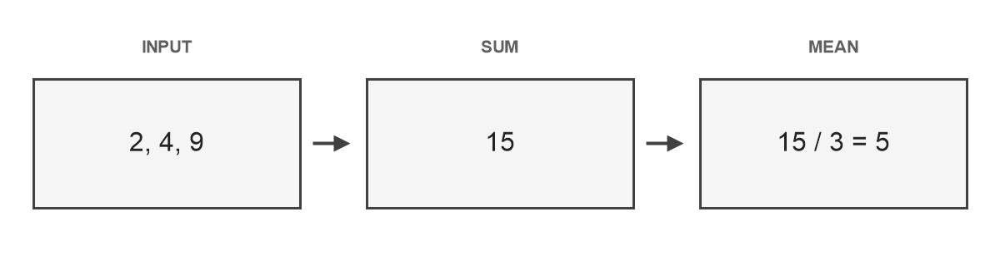

# 从笔记到讲义：一次计算复核

## 写下问题

一份可以复查的笔记，应当同时保存问题、计算条件和检查方法。
这里取三个观测值 $2$、$4$、$9$，用算术平均表示它们的中心位置。
样例中的文字、数值与命令为公开演示编写，命令只用于排版，不会运行。

$$
\bar{x}=\frac{2+4+9}{3}=5.
$$



## 保留推导与条件

令候选中心为 $a$，三个观测值到它的平方距离之和为

$$
S(a)=(2-a)^2+(4-a)^2+(9-a)^2=3(a-5)^2+26.
$$

平方项非负，所以当 $a=5$ 时取得最小值。这个结论保留了计算的对象，
也说明了为什么平均值适合作为这组三个数的中心。

| 检查项 | 本例结果 |
| --- | --- |
| 观测数量 | 三个 |
| 数值总和 | 十五 |
| 平均值 | 五 |

## 保存可复查的操作

JSON 可以记录一个简短的实验配置。下面的字段作为代码正文保留，
不会变成转换器设置。

```json
{"values": [2, 4, 9], "method": "mean", "expected": 5}
```

PowerShell 命令展示怎样检查一篇普通 Markdown 笔记。这里写的是相对路径，
实际使用时可以替换成自己的文件。

```powershell
$notePath = 'examples/05-first-lecture.md'
.\.venv\Scripts\python.exe note2lecture.py check $notePath --profile markdown
```

转换后先阅读 PDF，再保留完整 LaTeX 源包。两者配合，既方便阅读，
也允许之后继续修改文字和公式；原始笔记仍作为独立来源保存。
